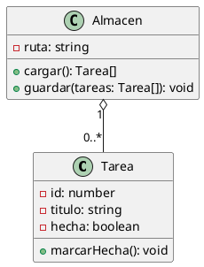

# Antes de empezar

## Qué vas a saber hacer al terminar esta unidad

Cubre el **RA2: instala y utiliza entornos de desarrollo, identificando sus características y
componentes**. Al acabarla tienes que ser capaz de:

- Describir qué componentes tiene un entorno de desarrollo y para qué sirve cada uno.
- Instalar y configurar VS Code y Node.js en Windows y en Linux, y dejarlo funcionando.
- Comparar entornos libres y comerciales con criterios objetivos.
- Crear un proyecto desde cero, con su gestión de dependencias y sus tareas automatizadas.
- Usar una herramienta CASE dentro del proceso de desarrollo.
- Aplicar normas de seguridad y buenas prácticas en el puesto de trabajo.

::: idea
Esta es la unidad más larga del módulo (27 h) y la más práctica. Al final tendrás un entorno de
trabajo montado, exportable y reproducible, y la versión 0.1 del proyecto **GestorTareas** que
usaremos en todas las unidades siguientes.
:::

\newpage

# Qué es un entorno de desarrollo

## Del editor al IDE

Puedes programar con el Bloc de notas y una terminal. Funciona. También puedes cortar el césped
con tijeras.

Un **entorno de desarrollo integrado** (IDE, *Integrated Development Environment*) es una
aplicación que reúne en un solo sitio todas las herramientas del proceso que viste en UD1:

| Componente | Qué aporta |
|----------------------------------------------|----------------------------------------------------------------|
| **Editor de código** | Resaltado de sintaxis, sangrado automático, plegado, multicursor |
| **Autocompletado (IntelliSense)** | Sugiere métodos y propiedades; evita erratas |
| **Compilador / intérprete integrado** | Construir y ejecutar sin salir del programa |
| **Depurador** | Puntos de ruptura, ejecución paso a paso, inspección de variables |
| **Gestor de proyectos** | Estructura de carpetas, configuración, *workspaces* |
| **Integración con control de versiones** | Ver cambios, hacer *commit*, resolver conflictos |
| **Refactorización asistida** | Renombrar, extraer método, mover clase |
| **Terminal integrada** | Ejecutar comandos sin cambiar de ventana |
| **Diseñador de interfaces** | Montar ventanas arrastrando componentes (no todos lo tienen) |
| **Sistema de extensiones** | Añadir soporte para lenguajes y herramientas |

::: ojo
Pregunta de examen frecuente: *«Enumera los componentes de un entorno de desarrollo»*. La
respuesta mínima aceptable: **editor, compilador/intérprete, depurador, y herramientas de
construcción y despliegue**. Todo lo demás suma.
:::

## ¿Es VS Code un IDE?

Técnicamente es un **editor de código extensible**: de fábrica no trae compilador ni depurador
para ningún lenguaje concreto. Con las extensiones adecuadas se comporta exactamente como un
IDE. En la práctica, y para este módulo, lo trataremos como un IDE.

| | Editor | IDE |
|-------------------------|------------------------------------|-------------------------------------------------|
| Ejemplos | Notepad++, Sublime, Vim | IntelliJ, Eclipse, Visual Studio, NetBeans |
| Arranque | Instantáneo | Lento |
| Consumo de RAM | Bajo | Alto (1-4 GB) |
| Refactorización | Buscar y reemplazar | Semántica, entiende el código |
| Lenguajes | Cualquiera (solo resaltado) | Uno o pocos, pero a fondo |
| VS Code | Nace aquí… | …y llega hasta aquí con extensiones |

\newpage

# Panorama de entornos de desarrollo

## Los principales

| IDE | Lenguajes fuertes | Licencia | Notas |
|-------------------|--------------------------|----------------------------|-------------------------------------|
| **Visual Studio Code** | JS/TS, Python, casi todo vía extensión | MIT (binarios de MS con licencia propia) | El más usado del mundo. Ligero, enorme catálogo de extensiones |
| **IntelliJ IDEA** | Java, Kotlin | Community (Apache 2.0) / Ultimate (pago) | El mejor refactorizador del mercado |
| **Eclipse** | Java | EPL (libre) | Veterano, base de muchos IDE corporativos |
| **NetBeans** | Java, PHP | Apache 2.0 | Muy usado en enseñanza; incluye diseñador de GUI |
| **Visual Studio** | C#, C++, .NET | Community gratis / Pro y Enterprise de pago | Solo Windows y Mac. Pesado pero muy completo |
| **PhpStorm / WebStorm** | PHP / JS | Pago (gratis para estudiantes) | Muy potentes en su nicho |
| **Android Studio** | Kotlin, Java (Android) | Apache 2.0 | Basado en IntelliJ |
| **Xcode** | Swift | Gratis, solo macOS | Obligatorio para publicar en App Store |

## Entornos en la nube

Cada vez más habituales: no instalas nada, el entorno vive en un servidor y tú trabajas desde el
navegador.

- **GitHub Codespaces**: un VS Code completo en la nube ligado a tu repositorio.
- **Gitpod**, **Replit**, **StackBlitz**, **CodeSandbox**: similares, con planes gratuitos.

**A favor**: cero instalación, mismo entorno para todo el equipo, accesible desde cualquier
ordenador. **En contra**: dependes de la conexión, hay límites de horas en los planes gratuitos,
y tu código está en un servidor ajeno.

## Libre vs comercial

Esto es un criterio de evaluación literal del currículo (RA2-e), así que merece cuidado.

| | Software libre | Software comercial/propietario |
|--------------------------|--------------------------------------|----------------------------------------------|
| **Coste** | Normalmente 0 € | Licencia por usuario/año |
| **Código fuente** | Disponible y modificable | Cerrado |
| **Soporte** | Comunidad, foros, Stack Overflow | Contrato de soporte con SLA |
| **Actualizaciones** | Frecuentes, a veces caóticas | Planificadas |
| **Personalización** | Total | La que permita el fabricante |
| **Continuidad** | Depende de la comunidad | Depende de la empresa |
| **Ejemplos** | Eclipse, NetBeans, VS Codium | IntelliJ Ultimate, Visual Studio Enterprise |

::: ojo
Cuidado con «gratis» ≠ «libre». Visual Studio Code es **gratuito**, y su código fuente es
libre (MIT), pero **los binarios que descargas de Microsoft** llevan telemetría y una licencia
propietaria. La versión 100 % libre se llama **VSCodium**. Es un matiz que gusta mucho en los
exámenes y en los debates de clase.
:::

::: practica
**P2.2 — Comparativa de entornos** (2 h, individual, evaluable con rúbrica)

Instala y prueba **tres** entornos: VS Code (obligatorio) y otros dos a elegir entre NetBeans,
Eclipse, IntelliJ IDEA Community y VS Codium.

En cada uno, haz exactamente lo mismo: crear un proyecto, escribir un «Hola mundo», ejecutarlo y
poner un punto de ruptura.

Rellena esta tabla y añade una conclusión razonada de 10 líneas:

| Criterio | VS Code | ___ | ___ |
|-------------------------------------------------------------|--------------------|--------------|--------------|
| Licencia y coste | | | |
| Tamaño de la descarga | | | |
| Tiempo de instalación | | | |
| Tiempo de arranque (2.º arranque) | | | |
| RAM en reposo (Administrador de tareas) | | | |
| Pasos hasta ejecutar un «Hola mundo» | | | |
| Calidad del autocompletado (1-5) | | | |
| Facilidad del depurador (1-5) | | | |
| Integración con Git (1-5) | | | |
| Curva de aprendizaje (1-5) | | | |
| ¿Para qué lo recomendarías? | | | |

**Rúbrica**: datos completos y verificables (40 %), comparación real y no copiada (30 %),
conclusión argumentada (20 %), presentación (10 %).
:::

\newpage

# Instalación y configuración de Visual Studio Code

## Instalación

**Windows**: descarga el instalador de `code.visualstudio.com`. Durante la instalación marca:

- *Agregar la acción «Abrir con Code» al menú contextual de archivos y directorios*.
- *Agregar a PATH* (imprescindible para poder escribir `code .` en la terminal).

**Ubuntu**: la forma limpia es el repositorio oficial de Microsoft.

```bash
sudo apt update && sudo apt install -y wget gpg apt-transport-https
wget -qO- https://packages.microsoft.com/keys/microsoft.asc \
  | gpg --dearmor > packages.microsoft.gpg
sudo install -D -o root -g root -m 644 packages.microsoft.gpg \
  /etc/apt/keyrings/packages.microsoft.gpg
echo "deb [arch=amd64 signed-by=/etc/apt/keyrings/packages.microsoft.gpg] \
https://packages.microsoft.com/repos/code stable main" \
  | sudo tee /etc/apt/sources.list.d/vscode.list
sudo apt update && sudo apt install -y code
```

::: ojo
También existe el paquete **snap** (`sudo snap install code --classic`). Funciona, pero arranca
más lento y da problemas de permisos con algunas extensiones. Para clase, mejor el repositorio.
:::

## La interfaz en cinco zonas

1. **Barra de actividad** (izquierda): Explorador, Búsqueda, Control de código fuente,
   Ejecución y depuración, Extensiones.
2. **Barra lateral**: el contenido de lo que hayas elegido arriba.
3. **Editor**: pestañas, grupos, división vertical/horizontal.
4. **Panel inferior**: Problemas, Salida, Consola de depuración, **Terminal**.
5. **Barra de estado**: rama de Git, errores/avisos, codificación, lenguaje, línea:columna.

## Atajos que hay que saberse (los 12 imprescindibles)

| Atajo | Qué hace |
|-------------------------------------------|-------------------------------------------------------------------|
| `Ctrl+Shift+P` | **Paleta de comandos**. El más importante de todos |
| `Ctrl+P` | Ir a fichero por nombre |
| `Ctrl+Shift+F` | Buscar en todos los ficheros |
| `Ctrl+ñ` (o `` Ctrl+` ``) | Abrir/cerrar terminal integrada |
| `Ctrl+B` | Mostrar/ocultar barra lateral |
| `F2` | Renombrar símbolo (¡en todo el proyecto!) |
| `Alt+↑ / Alt+↓` | Mover la línea actual |
| `Shift+Alt+↓` | Duplicar la línea |
| `Ctrl+D` | Seleccionar la siguiente ocurrencia (multicursor) |
| `Ctrl+/` | Comentar/descomentar |
| `Shift+Alt+F` | Formatear documento |
| `F5` | Iniciar depuración |

::: practica
**P2.1 — Ponerlo en marcha** (45 min)

1. Instala VS Code en Windows con las opciones indicadas.
2. Comprueba desde una terminal: `code --version`.
3. Crea la carpeta `C:\DAW\entornos` y ábrela con `code .`.
4. Crea `prueba.js` con `console.log('Hola ' + new Date().getFullYear());`.
5. Practica **cada uno de los 12 atajos** de la tabla y anota en un documento qué ha hecho cada
   uno en tu fichero.
6. Cambia el tema a uno claro y a uno oscuro. Cambia el tamaño de fuente a 16.
:::

## Configuración: `settings.json`

VS Code guarda su configuración en JSON. `Ctrl+Shift+P` → *Preferences: Open User Settings
(JSON)*.

```json
{
  "editor.fontSize": 15,
  "editor.tabSize": 2,
  "editor.insertSpaces": true,
  "editor.formatOnSave": true,
  "editor.rulers": [80, 120],
  "editor.minimap.enabled": false,
  "editor.bracketPairColorization.enabled": true,
  "files.autoSave": "afterDelay",
  "files.autoSaveDelay": 1000,
  "files.trimTrailingWhitespace": true,
  "files.insertFinalNewline": true,
  "files.eol": "\n",
  "terminal.integrated.defaultProfile.windows": "Git Bash",
  "workbench.colorTheme": "Default Dark Modern",
  "telemetry.telemetryLevel": "off",
  "[javascript]": {
    "editor.defaultFormatter": "esbenp.prettier-vscode"
  }
}
```

Hay **tres niveles** de configuración, y el de abajo gana:

1. **Usuario**: para todos tus proyectos. Se guarda en tu perfil.
2. **Espacio de trabajo**: en `.vscode/settings.json` dentro del proyecto. Se comparte por Git,
   así que todo el equipo trabaja igual.
3. **Carpeta**: en *workspaces* multi-carpeta.

::: idea
`"files.eol": "\n"` parece un detalle tonto y es la causa de la mitad de los conflictos de Git
tontos entre equipos mixtos Windows/Linux. Windows termina las líneas con `\r\n` y Linux con
`\n`; si no lo fijas, Git ve «todas las líneas modificadas» cada vez que alguien guarda.
:::

## Extensiones para este módulo

| Extensión | ID | Para qué |
|----------------------------|---------------------------------------------|-------------------------------------|
| Spanish Language Pack | `MS-CEINTL.vscode-language-pack-es` | Interfaz en español |
| ESLint | `dbaeumer.vscode-eslint` | Análisis estático (UD4) |
| Prettier | `esbenp.prettier-vscode` | Formateo automático (UD4) |
| GitLens | `eamodio.gitlens` | Historial de Git enriquecido (UD4) |
| Jest Runner | `firsttris.vscode-jest-runner` | Lanzar pruebas desde el editor (UD3) |
| PlantUML | `jebbs.plantuml` | Diagramas UML como texto (UD5, UD6) |
| Draw.io Integration | `hediet.vscode-drawio` | Diagramas visuales (UD5, UD6) |
| Code Spell Checker (ES) | `streetsidesoftware.code-spell-checker-spanish` | Erratas en comentarios |
| EditorConfig | `EditorConfig.EditorConfig` | Estilo común entre editores |
| Error Lens | `usernamehw.errorlens` | Ver el error en la propia línea |

Se pueden instalar de golpe desde la terminal:

```bash
code --install-extension dbaeumer.vscode-eslint
code --install-extension esbenp.prettier-vscode
code --install-extension eamodio.gitlens
code --install-extension jebbs.plantuml
```

## Perfiles: tu entorno, empaquetado

Los **perfiles** de VS Code (`Ctrl+Shift+P` → *Profiles: Create Profile*) agrupan extensiones +
configuración + atajos + fragmentos. Puedes exportarlos a un fichero y llevártelos a otro
ordenador. Es la respuesta moderna a «se me ha formateado el portátil».

## Fragmentos de código (*snippets*)

`Ctrl+Shift+P` → *Snippets: Configure Snippets* → `javascript.json`:

```json
{
  "Cabecera de fichero": {
    "prefix": "cab",
    "body": [
      "/**",
      " * $1",
      " * @author  ${2:Nombre Apellidos}",
      " * @date    ${CURRENT_DAY}/${CURRENT_MONTH}/${CURRENT_YEAR}",
      " */",
      "",
      "$0"
    ],
    "description": "Cabecera estándar del módulo"
  },
  "Test de Jest": {
    "prefix": "tj",
    "body": [
      "describe('${1:unidad}', () => {",
      "  test('${2:debería ...}', () => {",
      "    expect($3).toBe($4);",
      "  });",
      "});"
    ]
  }
}
```

::: practica
**P2.3 — Tu perfil ENDES** (2 h, evaluable)

1. Crea un perfil llamado `ENDES`.
2. Instala en él las 10 extensiones de la tabla.
3. Configura el `settings.json` de usuario con, al menos, las claves del ejemplo, y añade tres
   más que hayas investigado tú (documenta qué hace cada una).
4. Crea **dos fragmentos propios**: uno de cabecera de fichero y otro que tú elijas.
5. Cambia dos atajos de teclado a tu gusto (`Ctrl+K Ctrl+S`).
6. Exporta el perfil y entrégalo junto a un documento que explique cada decisión.
:::

\newpage

# Node.js y npm

## Por qué Node en un módulo de entornos

Necesitamos un motor para ejecutar JavaScript fuera del navegador y, sobre todo, necesitamos su
ecosistema de herramientas: gestor de dependencias, ejecución de tareas, pruebas automatizadas,
análisis estático. Todo lo que vas a usar en UD3 y UD4 vive en npm.

## Instalación

**Windows**: instalador LTS de `nodejs.org`. Marca *Automatically install the necessary tools*
solo si vas a compilar módulos nativos (no es nuestro caso).

**Ubuntu**: no uses `apt install nodejs` (versión antigua). Usa **nvm**, que además te permite
tener varias versiones a la vez:

```bash
curl -o- https://raw.githubusercontent.com/nvm-sh/nvm/v0.40.1/install.sh | bash
# reinicia la terminal
nvm install --lts
nvm use --lts
node --version && npm --version
```

::: idea
**nvm** (Node Version Manager) resuelve un problema muy real: el proyecto A necesita Node 18 y
el B necesita Node 22. Con `nvm use 18` cambias en un segundo. En Windows el equivalente es
`nvm-windows` o `fnm`.
:::

## El fichero `package.json`

Es el carné de identidad del proyecto. Se crea con `npm init` (o `npm init -y` para aceptar todo
por defecto).

```json
{
  "name": "gestor-tareas",
  "version": "0.1.0",
  "description": "Gestor de tareas por línea de comandos",
  "main": "src/index.js",
  "type": "module",
  "scripts": {
    "start": "node src/index.js",
    "dev": "node --watch src/index.js",
    "test": "jest",
    "lint": "eslint src",
    "format": "prettier --write \"src/**/*.js\"",
    "docs": "jsdoc -c jsdoc.json"
  },
  "keywords": ["tareas", "cli", "daw"],
  "author": "Nombre Apellidos",
  "license": "MIT",
  "dependencies": {
    "chalk": "^5.3.0"
  },
  "devDependencies": {
    "eslint": "^9.10.0",
    "jest": "^29.7.0",
    "prettier": "^3.3.3"
  }
}
```

### dependencies vs devDependencies

- **`dependencies`**: bibliotecas que tu aplicación necesita **para funcionar** en producción.
  Se instalan con `npm install <paquete>`.
- **`devDependencies`**: herramientas que solo hacen falta **para desarrollar**: el motor de
  pruebas, el formateador, el analizador. Se instalan con `npm install -D <paquete>`.

Cuando despliegues en un servidor harás `npm install --omit=dev` y te ahorrarás descargar Jest,
ESLint y compañía.

### Versionado semántico (semver)

`MAJOR.MINOR.PATCH`, por ejemplo `5.3.0`:

- **MAJOR**: cambios que rompen compatibilidad.
- **MINOR**: funcionalidad nueva compatible hacia atrás.
- **PATCH**: corrección de errores.

Los prefijos en `package.json` dicen **hasta dónde** acepta actualizarse npm:

| Notación | Significa | Aceptaría |
|-----------------------|-----------------------------------|----------------------------------------------------|
| `5.3.0` | Exactamente esa | 5.3.0 |
| `~5.3.0` | Parches | 5.3.0 … 5.3.9 |
| `^5.3.0` | Parches y menores | 5.3.0 … 5.99.99 (pero no 6.0.0) |
| `*` | Cualquiera | Lo que sea. No hagas esto |

::: ojo
`^0.3.0` **no** acepta `0.4.0`. Con versiones 0.x, `^` se comporta como `~`, porque se asume que
un proyecto que aún no ha llegado a 1.0 puede romper cosas en cualquier *minor*.
:::

### `package-lock.json` y `node_modules`

- **`node_modules/`**: donde npm descarga físicamente las bibliotecas. Puede tener decenas de
  miles de ficheros. **Nunca se sube a Git.**
- **`package-lock.json`**: la foto exacta de qué versión se instaló de cada cosa, incluidas las
  dependencias de tus dependencias. **Sí se sube a Git**, porque es lo que garantiza que en el
  ordenador de tu compañero se instale exactamente lo mismo.

| Comando | Qué hace |
|-----------------------------|---------------------------------------------------------------------------------|
| `npm install` | Instala según `package.json`, actualiza el lock |
| `npm ci` | Instala **exactamente** el lock. Borra `node_modules` antes. Es el que se usa en CI |
| `npm install -D <p>` | Añade como dependencia de desarrollo |
| `npm uninstall <p>` | Elimina |
| `npm outdated` | Qué dependencias tienen versión más nueva |
| `npm audit` | Vulnerabilidades conocidas |
| `npm run <script>` | Ejecuta un script de `package.json` |

\newpage

# Automatización de tareas

## Scripts de npm

La forma más sencilla de automatizar. Los defines en `package.json` y los lanzas con `npm run`.

```json
"scripts": {
  "start": "node src/index.js",
  "test": "jest",
  "lint": "eslint src",
  "lint:fix": "eslint src --fix",
  "format": "prettier --write \"src/**/*.js\"",
  "check": "npm run lint && npm run test",
  "clean": "node -e \"require('fs').rmSync('dist',{recursive:true,force:true})\"",
  "prebuild": "npm run clean",
  "build": "node scripts/build.js",
  "postbuild": "echo Construcción terminada"
}
```

Dos detalles útiles:

- `start` y `test` se pueden lanzar sin `run`: `npm test`, `npm start`.
- Los prefijos `pre` y `post` se ejecutan automáticamente antes y después. `npm run build`
  ejecuta en realidad `prebuild` → `build` → `postbuild`.

## Tareas de VS Code (`tasks.json`)

Permiten lanzar comandos desde `Ctrl+Shift+B` y, lo más interesante, **capturar los errores** de
la salida para que aparezcan en el panel *Problemas* con enlace al fichero y la línea.

`.vscode/tasks.json`:

```json
{
  "version": "2.0.0",
  "tasks": [
    {
      "label": "Ejecutar aplicación",
      "type": "npm",
      "script": "start",
      "group": { "kind": "build", "isDefault": true },
      "presentation": { "panel": "dedicated", "clear": true }
    },
    {
      "label": "Pasar pruebas",
      "type": "npm",
      "script": "test",
      "group": { "kind": "test", "isDefault": true }
    },
    {
      "label": "Comprobar todo",
      "dependsOn": ["Pasar pruebas", "Ejecutar aplicación"],
      "dependsOrder": "sequence"
    }
  ]
}
```

## Otras herramientas de construcción

Para que conozcas el panorama, aunque no las usemos:

| Herramienta | Mundo | Fichero |
|-----------------------------------------|-----------------------------------|-----------------------------------|
| **Make** | C, Unix, genérico | `Makefile` |
| **Maven** | Java | `pom.xml` |
| **Gradle** | Java, Android | `build.gradle` |
| **npm / pnpm scripts** | JavaScript | `package.json` |
| **Vite / webpack** | Front-end | `vite.config.js` |

::: practica
**P2.5 — Automatiza tu proyecto** (2 h)

Sobre el proyecto `gestor-tareas`:

1. Define al menos **cinco** scripts en `package.json`: `start`, `dev`, `clean`, `format` y uno
   que combine varios con `&&`.
2. Crea un script `preclean` que muestre un aviso antes de borrar.
3. Crea `.vscode/tasks.json` con tres tareas, una de ellas como tarea de construcción por
   defecto (comprueba que `Ctrl+Shift+B` la lanza).
4. Documenta en el `README.md` qué hace cada script.
5. **Cuestión**: ¿qué diferencia hay entre `npm install` y `npm ci`? ¿Cuál usarías en un
   servidor de integración continua y por qué?
:::

\newpage

# Estructura de un proyecto

## Convención habitual en Node

```
gestor-tareas/
├── .vscode/
│   ├── settings.json      → configuración compartida del proyecto
│   ├── tasks.json         → tareas
│   └── launch.json        → configuración del depurador (UD3)
├── src/                   → código fuente
│   ├── index.js           → punto de entrada
│   ├── tarea.js
│   └── almacen.js
├── test/                  → pruebas (UD3)
│   └── tarea.test.js
├── docs/                  → documentación generada (UD4)
├── data/
│   └── tareas.json
├── .editorconfig
├── .gitignore
├── .env                   → secretos. NUNCA a Git
├── .env.example           → plantilla sin secretos. Sí a Git
├── package.json
├── package-lock.json
└── README.md
```

## `.editorconfig`

Fija el estilo básico independientemente del editor que use cada uno:

```ini
root = true

[*]
charset = utf-8
end_of_line = lf
insert_final_newline = true
trim_trailing_whitespace = true
indent_style = space
indent_size = 2

[*.md]
trim_trailing_whitespace = false
```

## `.gitignore`

```gitignore
node_modules/
dist/
coverage/
.env
*.log
.DS_Store
.idea/
```

::: ojo
`.env` en `.gitignore` es una **norma de seguridad**, no una manía. Subir claves de API a un
repositorio público es uno de los incidentes de seguridad más frecuentes del sector; hay robots
que rastrean GitHub buscándolas y las explotan en minutos. Y borrarlo después no sirve: sigue
en el historial de Git.
:::

::: practica
**P2.6 — GestorTareas v0.1** (2 h, guiada)

Construye la primera versión funcional del proyecto. Requisitos mínimos:

- Estructura de carpetas como la de arriba.
- `src/index.js` lee argumentos de la línea de comandos (`process.argv`).
- Comandos: `añadir "texto"`, `listar`, `hecha <id>`, `borrar <id>`.
- Los datos se guardan en `data/tareas.json`.
- Cada tarea tiene `id`, `titulo`, `hecha` (booleano) y `creada` (fecha ISO).
- Salida con colores usando la dependencia `chalk`.

Esqueleto de partida:

```javascript
// src/almacen.js
import { readFileSync, writeFileSync, existsSync, mkdirSync } from 'node:fs';
import { dirname } from 'node:path';

const RUTA = 'data/tareas.json';

export function cargar() {
  if (!existsSync(RUTA)) return [];
  return JSON.parse(readFileSync(RUTA, 'utf8'));
}

export function guardar(tareas) {
  mkdirSync(dirname(RUTA), { recursive: true });
  writeFileSync(RUTA, JSON.stringify(tareas, null, 2), 'utf8');
}
```

```javascript
// src/index.js
import chalk from 'chalk';
import { cargar, guardar } from './almacen.js';

const [ , , comando, ...args ] = process.argv;

switch (comando) {
  case 'añadir': {
    const tareas = cargar();
    tareas.push({
      id: tareas.length ? Math.max(...tareas.map(t => t.id)) + 1 : 1,
      titulo: args.join(' '),
      hecha: false,
      creada: new Date().toISOString(),
    });
    guardar(tareas);
    console.log(chalk.green('Tarea añadida'));
    break;
  }
  // TODO: listar, hecha, borrar
  default:
    console.log(chalk.yellow('Uso: node src/index.js <añadir|listar|hecha|borrar>'));
}
```

**Tu trabajo**: completar `listar`, `hecha` y `borrar`. Guarda este proyecto: lo vas a
refactorizar en UD4, probar en UD3 y modelar en UD5 y UD6.
:::

\newpage

# Entornos reproducibles: máquinas virtuales y contenedores

## Por qué

«En mi máquina funciona» es el clásico del sector. Las causas: versiones distintas de Node, de
la base de datos, del sistema operativo, variables de entorno distintas. Dos soluciones:

## Máquinas virtuales

Un programa (**hipervisor**) simula un ordenador completo dentro del tuyo, con su propio sistema
operativo. VirtualBox (libre, Oracle), VMware Workstation Player, Hyper-V (Windows Pro).

- **A favor**: aislamiento total; puedes tener Ubuntu dentro de Windows; *snapshots* para volver
  atrás si rompes algo.
- **En contra**: pesadas (varios GB de RAM y disco), arranque lento.

## Contenedores

Un contenedor (**Docker**) no simula un ordenador: comparte el núcleo del sistema anfitrión y
aísla solo el sistema de ficheros y los procesos. Es mucho más ligero.

| | Máquina virtual | Contenedor |
|------------------------|----------------------------------|----------------------------------------------------|
| Incluye | SO completo | Solo la aplicación y sus dependencias |
| Tamaño | 2-20 GB | 50-500 MB |
| Arranque | 30 s - 2 min | < 1 s |
| Aislamiento | Total | Del proceso |
| Herramienta | VirtualBox, VMware | Docker, Podman |

VS Code tiene **Dev Containers**: defines el entorno en un fichero y el editor arranca dentro del
contenedor. Todo el equipo trabaja exactamente con la misma versión de todo. Lo verás a fondo en
2.º, en *Despliegue de Aplicaciones Web*.

::: practica
**P2.7 — El mismo proyecto, otro sistema operativo** (2 h)

1. Instala VirtualBox y crea una máquina con Ubuntu Desktop (o usa la que ya tengas del módulo
   de Sistemas Informáticos).
2. Dentro de Ubuntu: instala VS Code por repositorio y Node por nvm.
3. Copia (o clona, si ya lo tienes en Git) `gestor-tareas` dentro de la máquina virtual.
4. `npm install` y ejecútalo.
5. **Documenta**: qué ha funcionado igual, qué ha cambiado (rutas, terminal, atajos), y cuánto
   has tardado.
6. Haz un *snapshot* de la máquina cuando lo tengas todo funcionando.
:::

\newpage

# Herramientas CASE

## Qué son

**CASE** = *Computer-Aided Software Engineering*: herramientas que asisten en las fases del
ciclo de vida **más allá** de escribir código: análisis, diseño, documentación, generación
automática, gestión del proyecto.

| Clasificación | Qué cubre | Ejemplos |
|--------------------------|----------------------------------|--------------------------------------------------|
| **Upper CASE** | Análisis y diseño (fases altas) | Herramientas de modelado de requisitos, diagramas UML |
| **Lower CASE** | Codificación, pruebas, mantenimiento | Generadores de código, depuradores, herramientas de pruebas |
| **I-CASE (integradas)** | Todo el ciclo de vida | Enterprise Architect, Rational Rose |

## Funciones típicas

- Editor de diagramas (UML, entidad-relación).
- **Repositorio** centralizado del modelo, compartido por el equipo.
- **Generación de código** a partir del modelo (*forward engineering*).
- **Ingeniería inversa**: obtener el modelo a partir del código existente.
- Comprobación de consistencia entre diagramas.
- Generación de documentación.

## Las que usaremos

| Herramienta | Tipo | Notas |
|-----------------------------|------------------------|---------------------------------------------------------|
| **draw.io** (diagrams.net) | Diagramas visuales | Libre, gratis, funciona en el navegador y como extensión de VS Code |
| **PlantUML** | Diagramas como texto | Libre. Escribes texto, genera la imagen. Versionable en Git |
| **StarUML** | UML completo | De pago con versión de evaluación. Genera código |
| **Visual Paradigm** | I-CASE | Versión Community gratuita para uso no comercial |
| **Enterprise Architect** | I-CASE | Comercial, estándar en grandes empresas |

## PlantUML: el diagrama como código

Esta es la opción que más nos interesa, porque un diagrama escrito en texto **se versiona en Git
igual que el código** y se puede revisar en un *pull request*. Un diagrama `.png` no.



::: practica
**P2.8 — Primer contacto con las CASE** (2 h)

1. Instala la extensión **PlantUML** en VS Code. Necesita Java instalado; compruébalo con
   `java -version` y si falta, instálalo (`sudo apt install default-jre` / instalador de Adoptium).
2. Crea `docs/modelo.puml` con el ejemplo de arriba y visualízalo con `Alt+D`.
3. Amplíalo: añade una clase `Etiqueta` relacionada con `Tarea`.
4. Instala la extensión **Draw.io Integration**. Crea `docs/arquitectura.drawio` con un esquema
   de las tres capas del sistema.
5. **Compara**: escribe 10 líneas sobre qué te ha parecido más cómodo y cuál elegirías para
   trabajar en equipo. Piensa en qué pasa si dos personas modifican el mismo diagrama a la vez.
:::

\newpage

# Seguridad y buenas prácticas en el puesto de desarrollo

Criterio RA2-g. No es relleno: es lo que separa a un profesional de alguien que «sabe programar».

## Seguridad

- **Nunca** claves, tokens ni contraseñas en el código. Van en variables de entorno (`.env`) y
  el `.env` va en `.gitignore`.
- Sube siempre un `.env.example` con las claves vacías, para que otro sepa qué necesita.
- Revisa las dependencias: `npm audit`. Una aplicación Node normal arrastra cientos de paquetes
  de terceros; cada uno es una superficie de ataque.
- Desconfía de las extensiones de VS Code con pocas descargas: se ejecutan con tus permisos.
- Actualiza. Las vulnerabilidades conocidas (CVE) son las que más se explotan.

## Copias de seguridad y trazabilidad

- Todo proyecto, desde el minuto uno, en un repositorio Git (UD4). Es tu copia de seguridad y tu
  máquina del tiempo.
- Nada de `proyecto_v2_final_FINAL_bueno.zip`.

## Ergonomía y salud (transversal del módulo)

- Pantalla a la altura de los ojos, a un brazo de distancia.
- Espalda apoyada, pies en el suelo, antebrazos horizontales.
- **Regla 20-20-20**: cada 20 minutos, mira 20 segundos a algo a 20 pies (6 m).
- Levántate cada hora. Dos horas seguidas sentado en la sesión larga son muchas.
- Tamaño de fuente suficiente: forzar la vista no te hace mejor programador.

::: practica
**P2.9 — Dossier del entorno de trabajo** (2 h, ENTREGA EVALUABLE DE LA UNIDAD)

Entrega un documento (PDF) y un repositorio con:

**Parte A — El entorno** (50 %)

1. Capturas y explicación de la instalación de VS Code y Node en Windows **y** en Ubuntu.
2. Tu `settings.json` comentado línea a línea.
3. Lista de extensiones instaladas y para qué sirve cada una.
4. Tus fragmentos de código propios.
5. Fichero de perfil exportado.

**Parte B — El proyecto** (50 %)

1. `gestor-tareas` funcionando, con los cuatro comandos.
2. Estructura de carpetas correcta, con `.gitignore` y `.editorconfig`.
3. `package.json` con al menos 5 scripts.
4. `.vscode/tasks.json` con 3 tareas.
5. `README.md` explicando cómo instalar y usar el proyecto.
6. Demostración en clase: el proyecto funcionando en las dos máquinas.

**Rúbrica**

| Criterio | Peso | Nivel alto | Nivel medio | Nivel bajo |
|-------------------------|---------|---------------------------------------|--------------------|----------------|
| Instalación y configuración | 25 % | Ambos SO, documentado y reproducible | Un SO bien | Incompleta |
| Personalización del entorno | 20 % | Perfil, snippets propios, atajos, todo justificado | Configuración básica | Por defecto |
| Proyecto funcionando | 30 % | 4 comandos + manejo de errores | 4 comandos | Falla alguno |
| Estructura y automatización | 15 % | Estructura limpia, scripts y tareas útiles | Lo mínimo | Desordenado |
| Documentación | 10 % | README claro y completo | README básico | Sin README |
:::

\newpage

# Resumen de la unidad

| Concepto | En una línea |
|--------------------------------------|------------------------------------------------------------------------|
| IDE | Entorno que integra editor, compilador/intérprete, depurador y herramientas |
| Editor vs IDE | El editor edita; el IDE entiende el código |
| VS Code | Editor extensible que se comporta como IDE; gratuito, código MIT |
| VSCodium | La compilación 100 % libre de VS Code, sin telemetría |
| Libre vs comercial | Coste, acceso al fuente, soporte, continuidad |
| `settings.json` | Configuración en 3 niveles: usuario, espacio de trabajo, carpeta |
| Perfil | Extensiones + configuración + atajos, exportable |
| Node.js | Motor para ejecutar JavaScript fuera del navegador |
| npm | Gestor de dependencias y ejecutor de scripts |
| `package.json` | Identidad del proyecto: metadatos, scripts, dependencias |
| dependencies vs devDependencies | Producción vs desarrollo |
| semver | MAJOR.MINOR.PATCH; `^` acepta menores, `~` solo parches |
| `package-lock.json` | Foto exacta de la instalación. Sí va a Git |
| `node_modules/` | Las bibliotecas descargadas. NO va a Git |
| `npm ci` | Instalación reproducible desde el lock; la de integración continua |
| Máquina virtual | Simula un ordenador completo; pesada y aislada |
| Contenedor | Comparte el núcleo; ligero y rápido |
| CASE | Herramienta que asiste en fases del ciclo de vida más allá del código |
| Upper / Lower CASE | Análisis y diseño / codificación y mantenimiento |
| PlantUML | Diagramas escritos como texto, versionables en Git |

# Autoevaluación

1. Cita cinco componentes de un IDE y qué aporta cada uno.
2. ¿Por qué VS Code es «gratuito pero no del todo libre»? ¿Qué alternativa hay?
3. Tienes `"chalk": "^5.3.0"`. ¿npm instalaría la 5.4.1? ¿Y la 6.0.0? ¿Y si pusiera `~5.3.0`?
4. ¿Qué ficheros de un proyecto Node **no** deben subirse nunca a Git, y por qué?
5. Tu compañero clona tu repositorio y le falla `npm start`. Da tres causas probables.
6. ¿Cuándo usarías una máquina virtual y cuándo un contenedor?
7. Diferencia entre `npm install` y `npm ci`.
8. ¿Qué ventaja tiene PlantUML sobre draw.io cuando trabajan tres personas sobre el mismo
   diagrama?
9. Explica qué son Upper CASE y Lower CASE, con un ejemplo de cada.
10. Enumera cuatro normas de seguridad en el puesto de desarrollo.
