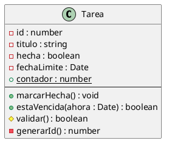
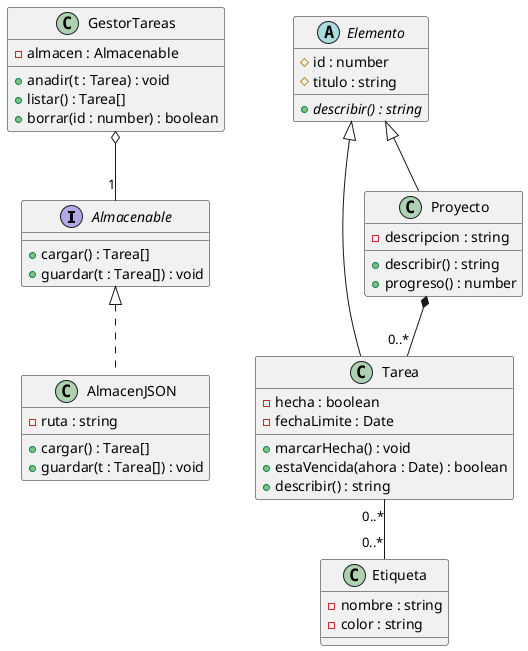
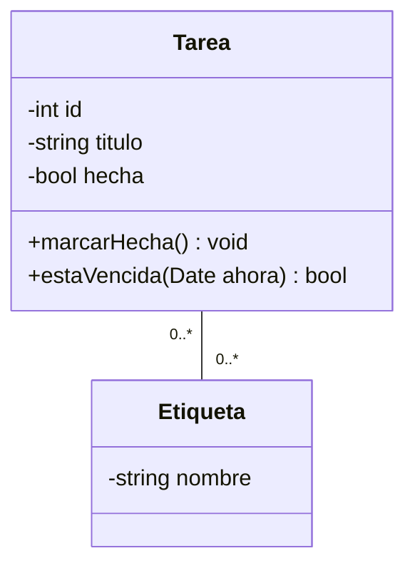

# Antes de empezar

## Qué vas a saber hacer al terminar esta unidad

Cubre el **RA5: representa la estructura de una aplicación mediante diagramas de clases**. Al
acabarla tienes que ser capaz de:

- Usar la notación UML de clases correctamente: visibilidad, atributos, métodos, estáticos,
  abstractos, interfaces.
- Distinguir y representar asociación, agregación, composición, herencia, dependencia y
  realización, con sus multiplicidades.
- Pasar de un enunciado de requisitos a un diagrama de clases razonable.
- Manejar al menos dos herramientas de modelado: PlantUML (texto) y Visual Paradigm (CASE).
- Generar código a partir de un diagrama y obtener un diagrama a partir de código
  (ingeniería inversa).

## Por qué un diagrama y no directamente el código

Porque un diagrama de clases de 15 clases cabe en una hoja y se entiende en dos minutos; el
código equivalente son 1.500 líneas repartidas en 15 ficheros. El diagrama sirve para tres
cosas concretas:

- **Pensar** el diseño antes de escribirlo, cuando cambiar de opinión es gratis.
- **Comunicar** el diseño al equipo y al cliente.
- **Documentar** un sistema existente para quien llegue nuevo.

\newpage

# Repaso de programación orientada a objetos

Necesitamos este repaso porque el diagrama de clases **es** la representación gráfica de los
conceptos de la POO. Si los conceptos no están claros, el diagrama no se entiende.

## Clase y objeto

- **Clase**: la plantilla, el molde. Define qué datos y qué comportamiento tendrán los objetos.
- **Objeto (instancia)**: un ejemplar concreto creado a partir de la clase, con sus propios
  valores.

> `Tarea` es la clase. `{id: 3, titulo: "Estudiar UML", hecha: false}` es un objeto.

## Atributos y métodos

- **Atributo** (campo, propiedad): un dato que guarda el objeto. `titulo`, `hecha`.
- **Método**: una operación que el objeto sabe hacer. `marcarHecha()`, `estaVencida()`.

## Los cuatro pilares

### Abstracción

Quedarse con lo esencial para el problema y descartar el resto. Una `Tarea` de un gestor
personal no necesita `presupuesto` ni `centroDeCoste`; en un gestor de proyectos de empresa, sí.
**El modelo depende del problema, no de la realidad.**

### Encapsulación

Los datos son privados y solo se tocan a través de métodos públicos. Así la clase controla su
propia coherencia.

```javascript
class Tarea {
  #hecha = false;              // privado de verdad en JavaScript moderno

  marcarHecha() {
    this.#hecha = true;
    this.#fechaCompletada = new Date();   // la clase garantiza la coherencia
  }

  get hecha() { return this.#hecha; }     // solo lectura desde fuera
}
```

### Herencia

Una clase hija **es un** tipo de la clase padre y reutiliza su estructura y comportamiento,
pudiendo añadir o redefinir.

```javascript
class Elemento { describir() { return this.titulo; } }
class Tarea extends Elemento {
  describir() { return `${super.describir()} ${this.hecha ? '[hecha]' : '[pendiente]'}`; }
}
```

### Polimorfismo

El mismo mensaje produce comportamientos distintos según el tipo real del objeto.

```javascript
const elementos = [new Tarea(...), new Proyecto(...), new Tarea(...)];
for (const e of elementos) console.log(e.describir());  // cada uno responde a su manera
```

::: ojo
Prueba clásica para saber si algo es herencia o no: **la regla «es un»**. Un `Proyecto` **es un**
`Elemento` → herencia. Un `Proyecto` **tiene** `Tarea`s → **no** es herencia, es composición. Una
de las malas prácticas más comunes es usar herencia donde tocaba composición.
:::

## Clase abstracta e interfaz

- **Clase abstracta**: no se puede instanciar. Define comportamiento común y deja métodos sin
  implementar para que los completen las hijas. En UML se escribe *en cursiva*.
- **Interfaz**: un contrato, solo firmas de métodos, sin implementación. Una clase que la
  implementa se compromete a tener esos métodos.

JavaScript no tiene `interface` ni `abstract` en el lenguaje (TypeScript sí), pero el concepto
se modela igual y se documenta en el diagrama.

\newpage

# UML: el lenguaje

## Qué es

**UML** (*Unified Modeling Language*) es un lenguaje **gráfico y estándar** para especificar,
visualizar y documentar sistemas software. Lo estandariza el **OMG** (*Object Management Group*);
la versión actual es la 2.5.

Dos cosas que UML **no** es: no es una metodología (no te dice cómo trabajar) y no es un lenguaje
de programación (no se ejecuta).

## Los 14 diagramas de UML 2.5

```
                          Diagramas UML
                    ┌───────────┴───────────┐
              ESTRUCTURA               COMPORTAMIENTO
                    │                          │
  ┌─ Clases         │        ┌─ Casos de uso   │
  ├─ Objetos        │        ├─ Actividad      │
  ├─ Componentes    │        ├─ Estados        │
  ├─ Despliegue     │        └─ Interacción ───┤
  ├─ Paquetes       │              ├─ Secuencia
  ├─ Perfiles       │              ├─ Comunicación
  ├─ Estructura     │              ├─ Tiempos
  │  compuesta      │              └─ Visión general
  └─ Objetos        │                  de interacción
```

En este módulo vemos **clases** (esta unidad) y los de comportamiento (UD6). Los demás conviene
saber nombrarlos.

| Diagrama | Para qué sirve |
|--------------------------------|------------------------------------------------------------------------------|
| **Clases** | Estructura estática: qué clases hay y cómo se relacionan |
| Objetos | Una foto de instancias concretas en un momento dado |
| Componentes | Módulos de software y sus interfaces |
| Despliegue | En qué máquinas y servidores vive cada parte |
| Paquetes | Organización en agrupaciones lógicas |
| **Casos de uso** | Qué puede hacer cada tipo de usuario |
| **Secuencia** | Mensajes entre objetos ordenados en el tiempo |
| **Comunicación** | Los mismos mensajes, centrados en quién habla con quién |
| **Estados** | Los estados por los que pasa un objeto y qué los provoca |
| **Actividad** | Un flujo de trabajo o algoritmo, con decisiones y paralelismo |

\newpage

# El diagrama de clases

## Notación de una clase

Una clase es un rectángulo con **tres compartimentos**: nombre, atributos y operaciones.


El código PlantUML que la genera:



### Visibilidad

| Símbolo | Nombre | Quién accede |
|------------------------|----------------------------|----------------------------------------------------------|
| `+` | Público | Todo el mundo |
| `-` | Privado | Solo la propia clase |
| `#` | Protegido | La clase y sus descendientes |
| `~` | Paquete | Clases del mismo paquete |

### Sintaxis completa

**Atributo**: `visibilidad nombre : tipo [multiplicidad] = valorPorDefecto {propiedades}`

```
- titulo : string
- etiquetas : Etiqueta [0..*]
- hecha : boolean = false
+ MAX_TITULO : number = 200 {readOnly}
```

**Operación**: `visibilidad nombre(parámetros) : tipoDeRetorno`

```
+ estaVencida(ahora : Date) : boolean
+ buscar(texto : string, soloPendientes : boolean = true) : Tarea [0..*]
```

### Convenios de presentación

| Elemento | Cómo se representa |
|----------------------------------------|----------------------------------------------------------------------|
| **Clase abstracta** | Nombre *en cursiva* (o `{abstract}`) |
| **Método abstracto** | Nombre *en cursiva* |
| **Miembro estático** | Subrayado |
| **Interfaz** | Estereotipo `<<interface>>` sobre el nombre |
| **Enumerado** | Estereotipo `<<enumeration>>` |

::: idea
En un diagrama no hay que poner **todo**. Se pone lo que es relevante para lo que quieres
comunicar. Un diagrama de arquitectura general puede llevar solo los nombres de las clases; uno
destinado a generar código lleva todos los atributos y tipos. **Un diagrama con 40 clases y todos
sus getters es ilegible y por tanto inútil.**
:::

\newpage

# Relaciones entre clases

Esta es la parte que más se pregunta y donde más se confunde la gente.


## Asociación

Una clase **usa** o **conoce** a otra de forma estable. Línea simple, con flecha si la
navegabilidad es en un solo sentido.

```
Usuario ──────> Tarea
```

Se le pueden poner: **nombre de la asociación** («posee»), **roles** en cada extremo
(`propietario`, `tareas`) y **multiplicidad**.

### Multiplicidad

| Notación | Significa |
|----------------------------------------------|----------------------------------------------------------------|
| `1` | Exactamente uno |
| `0..1` | Cero o uno (opcional) |
| `*` o `0..*` | Cero o muchos |
| `1..*` | Uno o muchos |
| `2..5` | Entre dos y cinco |

Se lee en los dos sentidos: `Usuario "1" -- "0..*" Tarea` significa *«un usuario tiene de cero a
muchas tareas, y cada tarea pertenece exactamente a un usuario»*.

## Agregación

Relación **«tiene un»** en la que las partes **pueden existir sin el todo**. Rombo **blanco** en
el lado del todo.

> Un `Departamento` agrega `Profesor`es. Si se disuelve el departamento, los profesores siguen
> existiendo.

## Composición

Relación **«tiene un»** más fuerte: las partes **no pueden existir sin el todo** y se destruyen
con él. Rombo **negro** en el lado del todo.

> Un `Pedido` compone `LineaPedido`. Si se borra el pedido, sus líneas no tienen sentido
> y desaparecen.

::: ojo
**Agregación vs composición** es la pregunta estrella. El criterio es el **ciclo de vida**:

- Si al destruir el todo las partes deben destruirse → **composición** (rombo negro).
- Si sobreviven → **agregación** (rombo blanco).

Segundo criterio: en composición, una parte pertenece a **un solo** todo; en agregación puede
ser compartida.

Y un aviso honesto: en la práctica profesional la distinción se usa poco y mucha gente pone
agregación por defecto. En el examen, sin embargo, se pregunta.
:::

## Herencia / generalización

Relación **«es un»**. Línea con **triángulo hueco** apuntando a la clase padre.

```
Elemento <|-- Tarea
Elemento <|-- Proyecto
```

## Realización (implementación)

Una clase implementa una interfaz. Línea **discontinua** con **triángulo hueco**.

```
Almacenable <|.. AlmacenJSON
```

## Dependencia

Relación **débil y temporal**: la clase A usa a B en algún momento (como parámetro, variable
local o valor de retorno), pero no la guarda. Línea **discontinua** con flecha abierta.

```
GeneradorInformes ..> Tarea
```

## Resumen visual

| Relación | Línea | Extremo | Lectura |
|-----------------------|-------------------|---------------------------------|-----------------------------------|
| Asociación | Continua | Flecha abierta (opcional) | «conoce a» |
| Agregación | Continua | Rombo **blanco** | «tiene» (parte independiente) |
| Composición | Continua | Rombo **negro** | «tiene» (parte dependiente) |
| Generalización | Continua | Triángulo **hueco** | «es un» |
| Realización | Discontinua | Triángulo **hueco** | «implementa» |
| Dependencia | Discontinua | Flecha **abierta** | «usa temporalmente» |

## Ejemplo completo


En este diagrama puedes identificar los seis tipos de relación:

- `GestorTareas` **agrega** un `Almacenable` (rombo blanco): el almacén se le inyecta desde
  fuera y podría existir sin el gestor.
- `Proyecto` **compone** `Tarea`s (rombo negro): si se borra el proyecto, sus tareas se van con
  él.
- `Tarea` y `Proyecto` **heredan** de `Elemento`.
- `AlmacenJSON` **realiza** la interfaz `Almacenable` (línea discontinua).
- `Tarea` y `Etiqueta` se **asocian** con multiplicidad muchos a muchos.
- `Elemento` es **abstracta** (nombre en cursiva) y `describir()` es un **método abstracto**.



::: practica
**P5.1 — Leer diagramas** (1 h, en parejas)

Se entregan tres diagramas de clases (en Moodle). Para cada uno, responde por escrito:

1. ¿Cuántas clases hay? ¿Alguna es abstracta o es una interfaz?
2. Enumera todas las relaciones indicando **tipo** y **multiplicidad**, y **léelas en voz alta**
   en castellano («un X tiene de 0 a muchos Y»).
3. ¿Qué pasaría si borrásemos un objeto de la clase X? ¿Qué otros objetos desaparecerían?
4. Escribe el esqueleto en JavaScript de dos de las clases.
5. Señala **un error de modelado** en cada diagrama y propón cómo arreglarlo. (Los hay: uno
   tiene una herencia donde debería haber composición, otro una multiplicidad imposible y otro
   una clase que hace dos cosas.)
:::

\newpage

# De los requisitos al diagrama

## El método de los sustantivos (Abbott)

Es una heurística sencilla y sorprendentemente eficaz para arrancar:

1. Escribe el enunciado del problema en prosa.
2. **Subraya los sustantivos** → candidatos a **clases** o **atributos**.
3. **Subraya los verbos** → candidatos a **métodos** o **relaciones**.
4. **Subraya los adjetivos** → candidatos a **atributos** o **subclases**.
5. **Depura**: elimina sinónimos, sustantivos fuera del ámbito, y los que son atributos simples
   en vez de clases.

## Ejemplo

> *«El **usuario** puede **crear tareas** con un **título** y una **fecha límite** opcional. Cada
> tarea puede tener varias **etiquetas**. Las tareas se **agrupan** en **proyectos**. El usuario
> puede **marcar** una tarea como **hecha** y **borrarla**. El sistema debe **avisar** de las
> tareas **vencidas**.»*

**Sustantivos**: usuario, tarea, título, fecha límite, etiqueta, proyecto, sistema.

**Depuración**:

- `título` y `fecha límite` → no son clases, son **atributos** de `Tarea`.
- `sistema` → no es una clase, es el propio programa.
- `usuario` → ¿es una clase? En esta versión solo hay un usuario y no guardamos nada de él →
  **fuera del ámbito** (sería un actor en el diagrama de casos de uso de UD6).
- Quedan: **Tarea, Etiqueta, Proyecto** (+ las clases técnicas que añadamos: `GestorTareas`,
  `AlmacenJSON`).

**Verbos**: crear, agrupar, marcar, borrar, avisar → métodos `crear()`, `marcarHecha()`,
`borrar()`, `avisarVencidas()`; y `agrupar` sugiere la **relación** Proyecto–Tarea.

**Adjetivos**: opcional (multiplicidad `0..1`), vencida (estado derivado, un método
`estaVencida()`).

## Señales de un mal diseño

- Una clase con **un solo atributo y ningún método**: probablemente era un atributo.
- Una clase con **20 métodos** que no tienen relación entre sí: son dos clases.
- **Herencia de más de 3 niveles**: casi siempre se puede simplificar con composición.
- Clases llamadas `Gestor`, `Manager`, `Utils`, `Helper` que acumulan todo lo que no encaja en
  otro sitio: el cajón de sastre.
- Relaciones **bidireccionales por todas partes**: acoplamiento innecesario; pregúntate si de
  verdad `Etiqueta` necesita conocer sus `Tarea`s.

\newpage

# Herramientas

## draw.io (diagrams.net)

Editor visual, libre, sin instalar nada (aunque hay escritorio y extensión de VS Code). Se
arrastra y se suelta. Tiene plantillas UML.

- **A favor**: intuitivo, control total del aspecto, no hay que aprender sintaxis.
- **En contra**: el fichero es XML comprimido, así que **Git no puede fusionar dos cambios
  simultáneos**; no genera código.

## PlantUML

Escribes texto, se genera la imagen. Extensión de VS Code (`jebbs.plantuml`); requiere Java y,
para algunos diagramas, Graphviz.

- **A favor**: **versionable en Git**, revisable en un *pull request*, rápido de escribir, el
  diagrama se autoorganiza, integrable en la documentación generada.
- **En contra**: no controlas la colocación exacta; hay que aprender la sintaxis.

Atajos útiles: `Alt+D` vista previa. Exportar: `Ctrl+Shift+P` → *PlantUML: Export Current
Diagram*.

## Mermaid

Alternativa a PlantUML que se renderiza directamente en GitHub, GitLab y en muchos editores de
Markdown, **sin instalar nada**.

````markdown

````

## StarUML y Visual Paradigm

Herramientas CASE completas: repositorio del modelo, comprobación de consistencia, **generación
de código** e **ingeniería inversa**. StarUML tiene versión de evaluación indefinida; Visual
Paradigm tiene edición Community gratuita para uso no comercial.

| Herramienta | Libre | Versiona en Git | Genera código | Ing. inversa |
|--------------------|--------------------|--------------------|-----------------------|----------------------------|
| draw.io | Sí | Mal | No | No |
| PlantUML | Sí | **Muy bien** | Limitado (plugins) | Con herramientas externas |
| Mermaid | Sí | **Muy bien** | No | No |
| StarUML | No (evaluación) | Mal | **Sí** | **Sí** |
| Visual Paradigm | Community | Mal | **Sí** | **Sí** |

## Visual Paradigm, paso a paso

Es la herramienta que usa la mayoría de los centros de FP y la que presuponen casi todos los
enunciados que os vais a encontrar, así que conviene manejarla aunque en el día a día trabajéis
con PlantUML.

**Instalación (Community Edition, gratuita para uso no comercial)**

1. Descarga desde `visual-paradigm.com/download/community.jsp`. Hay versión para Windows, macOS
   y Linux, y también una versión portable que no requiere instalación.
2. Al arrancar por primera vez pide un correo para activar la licencia Community. Usa el del
   centro.
3. Elige el perfil **UML** cuando pregunte por el tipo de proyecto.

**El primer diagrama de clases**

1. Panel izquierdo → botón derecho sobre el proyecto → *New Diagram* → *Class Diagram*.
2. Arrastra la herramienta **Class** al lienzo y escribe el nombre.
3. Con la clase seleccionada, botón derecho → *Add* → *Attribute* / *Operation*. El símbolo de
   visibilidad (`+`, `-`, `#`, `~`) se cambia haciendo doble clic sobre él.
4. Para una relación: pasa el ratón por el borde de una clase, aparecen unos iconos flotantes;
   arrastra desde el icono de la relación que quieras hasta la clase destino.
5. **La multiplicidad**: haz clic sobre el extremo de la relación y escribe `1`, `0..1`, `*`,
   `1..*`. Si no la pones, Visual Paradigm no te avisa, pero en el examen cuenta como error.

::: ojo
Los cuatro fallos que más se repiten con esta herramienta:

1. **Confundir agregación y composición.** El rombo hueco es agregación (el todo puede existir
   sin las partes) y el relleno es composición (si se destruye el todo, se destruyen las partes).
   Están juntos en la barra de herramientas y se pinchan mal constantemente.
2. **Dejar los tipos de los atributos en blanco.** Se escriben con la sintaxis
   `nombre : Tipo`, en el propio campo del atributo.
3. **Usar *Generalization* donde va *Realization*.** Herencia entre clases es generalización
   (línea continua, triángulo hueco); implementar una interfaz es realización (línea
   discontinua, triángulo hueco).
4. **Exportar con *Print Screen*.** Usa *File → Export → PNG* (o PDF) y marca *Diagram only*: lo
   demás sale con marca de agua de la Community Edition y con los paneles de la interfaz.
:::

**Generación de código e ingeniería inversa**

- *Tools → Code → Instant Generator* → elige lenguaje (Java, Python, C#, PHP…) y carpeta de
  salida. Genera el esqueleto: clases, atributos, firmas de métodos. **El cuerpo de los métodos
  no lo escribe nadie por ti.**
- *Tools → Code → Instant Reverse* hace el camino contrario: le das el código fuente y te dibuja
  el diagrama. Es la forma más rápida de documentar un proyecto que ya existe, y también la más
  rápida de darse cuenta de que el diseño real no se parece al que se dibujó en su día.

::: idea
**Cuándo usar cada una.** Visual Paradigm cuando el entregable es el diagrama (un documento de
análisis, un examen, un proyecto que se presenta). PlantUML cuando el diagrama tiene que vivir
dentro del repositorio y evolucionar con el código, porque un `.puml` es texto y se ve en un
`git diff`; un fichero `.vpp` es binario y no se puede revisar en un Pull Request.
:::

\newpage

# Generación de código e ingeniería inversa

## Ingeniería directa (*forward engineering*)

Del diagrama al código. Las herramientas CASE generan el esqueleto: clases, atributos, firmas de
métodos y relaciones; el cuerpo de los métodos lo escribes tú.

Del diagrama de `Tarea` sale directamente:

```javascript
/**
 * @class Tarea
 */
export class Tarea {
  /** @type {number} */      #id;
  /** @type {string} */      #titulo;
  /** @type {boolean} */     #hecha = false;
  /** @type {Date|null} */   #fechaLimite = null;
  /** @type {Etiqueta[]} */  #etiquetas = [];

  static contador = 0;

  constructor({ id, titulo, fechaLimite = null }) {
    this.#id = id;
    this.#titulo = titulo;
    this.#fechaLimite = fechaLimite;
    Tarea.contador++;
  }

  /** @returns {void} */
  marcarHecha() { this.#hecha = true; }

  /**
   * @param {Date} [ahora=new Date()]
   * @returns {boolean}
   */
  estaVencida(ahora = new Date()) {
    return this.#fechaLimite !== null && !this.#hecha && this.#fechaLimite < ahora;
  }

  /** @protected @returns {boolean} */
  validar() { return this.#titulo.trim().length > 0; }
}
```

Reglas de traducción que hay que conocer:

| UML | JavaScript / TypeScript |
|------------------------------------------|--------------------------------------------------------------------|
| Clase | `class` |
| Atributo privado `-` | `#campo` (JS) o `private campo` (TS) |
| Atributo protegido `#` | Convenio `_campo` (JS) o `protected` (TS) |
| Método estático (subrayado) | `static` |
| Clase abstracta (cursiva) | `abstract class` (TS); en JS, error en el constructor |
| Interfaz | `interface` (TS); en JS, documentado con `@interface` |
| Generalización | `extends` |
| Realización | `implements` (TS) |
| Asociación `1 → 0..*` | Un array como atributo |
| Composición | El objeto se crea **dentro** del constructor del todo |
| Agregación | El objeto se **recibe** como parámetro |

::: idea
Esa última fila es muy útil y muy poco conocida: la diferencia entre composición y agregación se
**ve en el código**. En composición el todo hace `this.lineas = [new Linea(...)]`; en agregación
hace `constructor(almacen) { this.almacen = almacen; }`. Si lo crea, lo posee.
:::

## Ingeniería inversa (*reverse engineering*)

Del código al diagrama. Útil cuando llegas a un proyecto que lleva cinco años en marcha y nadie
te explica nada.

Opciones prácticas en el mundo JavaScript:

```bash
# tplant: genera PlantUML a partir de TypeScript
npx tplant --input "src/**/*.ts" --output docs/clases.puml

# Con Java (por si trabajáis con el otro stack)
# IntelliJ: clic derecho sobre el paquete → Diagrams → Show Diagram
# Eclipse: plugin ObjectAid o AmaterasUML
```

En VS Code, la extensión *Dependency Cruiser* o *Madge* genera grafos de dependencias entre
módulos, que no es exactamente un diagrama de clases pero cumple una función parecida.

::: practica
**P5.2 — Modelar desde cero: Biblioteca** (2 h)

> *«Una biblioteca gestiona libros. De cada libro se guarda ISBN, título, año y uno o varios
> autores; de cada autor, nombre y nacionalidad. La biblioteca tiene varios ejemplares físicos de
> cada libro, cada uno con un código de barras y un estado (disponible, prestado, en
> reparación). Los socios, con número de socio, nombre y correo, pueden tomar prestados
> ejemplares: cada préstamo registra la fecha de inicio, la fecha de devolución prevista y la
> real. Un socio no puede tener más de tres préstamos activos. Hay dos tipos de socio: adulto e
> infantil; el infantil solo puede llevarse libros marcados como juveniles.»*

1. Aplica el **método de los sustantivos**: lista completa, y depuración justificada (di qué
   descartas y por qué).
2. Dibuja el diagrama de clases con **PlantUML**. Debe incluir, obligatoriamente, al menos: una
   herencia, una composición, una agregación, un enumerado y una asociación con clase asociativa
   o intermedia.
3. Pon **todas** las multiplicidades y al menos dos roles con nombre.
4. **Justifica en texto** por qué la relación Libro–Ejemplar es composición y no agregación.
5. ¿Dónde modelas la restricción «no más de tres préstamos activos»? (Pista: UML tiene
   restricciones `{...}`.)
6. Genera el código JavaScript de **tres** de las clases, siguiendo la tabla de traducción.
:::

::: practica
**P5.3 — Entrega evaluable de la unidad** (2 h + trabajo en casa)

**Parte A — Ingeniería directa** (50 %)

1. Diagrama de clases **completo** de `GestorTareas` tal y como está tu proyecto ahora, en
   PlantUML, versionado en `docs/clases.puml`.
2. Debe reflejar fielmente el código: si en el código no hay una clase `Proyecto`, no la pongas.
3. Amplía el diseño con dos clases nuevas que te gustaría añadir, marcándolas con una nota UML.
4. Genera el esqueleto de código de esas dos clases nuevas, documentado con JSDoc.

**Parte B — Ingeniería inversa** (35 %)

1. Clona un repositorio pequeño de JavaScript o TypeScript que **no sea tuyo** (te propongo tres
   en Moodle, o elige uno con menos de 20 ficheros).
2. Obtén su diagrama de clases: con `tplant` si es TypeScript, o a mano leyendo el código.
3. Escribe media página explicando **qué has entendido del diseño** gracias al diagrama y qué
   te ha costado más.

**Parte C — Comparación de herramientas** (15 %)

Haz **el mismo** diagrama de la parte A en **Visual Paradigm** (Community). Exporta a PNG con
*Diagram only*. Compara ambas experiencias en 15 líneas:
tiempo, comodidad, control del resultado, y qué pasa si tres personas lo editan a la vez.

**Rúbrica**

| Criterio | Peso | Nivel alto | Nivel medio | Nivel bajo |
|----------------------|--------|------------------------------------|------------------|--------------------------|
| Corrección de la notación | 25 % | Visibilidad, tipos, cursivas, estereotipos: todo correcto | Algún despiste | Notación inventada |
| Relaciones y multiplicidades | 25 % | Tipo adecuado y multiplicidad en todas | Alguna dudosa | Todo asociaciones sin multiplicidad |
| Fidelidad al código | 20 % | El diagrama y el código coinciden | Pequeñas discrepancias | No se parecen |
| Ingeniería inversa | 20 % | Diagrama correcto y análisis con criterio | Diagrama correcto | Superficial |
| Comparación de herramientas | 10 % | Argumentada con datos | Genérica | Ausente |
:::

\newpage

# Resumen de la unidad

| Concepto | En una línea |
|---------------------------------------|-----------------------------------------------------------------------|
| Clase / objeto | Molde / ejemplar concreto |
| Abstracción | Quedarse con lo esencial para el problema |
| Encapsulación | Datos privados, acceso por métodos |
| Herencia | Relación «es un»; reutiliza y extiende |
| Polimorfismo | Mismo mensaje, comportamientos distintos |
| Clase abstracta | No se instancia; en UML va en cursiva |
| Interfaz | Contrato de métodos; estereotipo `<<interface>>` |
| UML | Lenguaje gráfico estándar del OMG; 14 diagramas en la 2.5 |
| `+ - # ~` | Público, privado, protegido, paquete |
| Miembro estático | Subrayado |
| Asociación | Línea simple; «conoce a» |
| Multiplicidad | `1`, `0..1`, `*`, `1..*`, `2..5` |
| Agregación | Rombo **blanco**; la parte sobrevive al todo |
| Composición | Rombo **negro**; la parte muere con el todo |
| Generalización | Triángulo hueco, línea continua |
| Realización | Triángulo hueco, línea discontinua |
| Dependencia | Flecha abierta, línea discontinua; uso temporal |
| Método de los sustantivos | Sustantivos → clases; verbos → métodos |
| Ingeniería directa | Del diagrama al código |
| Ingeniería inversa | Del código al diagrama |
| PlantUML vs Visual Paradigm | Texto versionable vs CASE completa con generación de código |

# Autoevaluación

1. Un `Motor` y un `Coche`: ¿agregación o composición? ¿Y un `Coche` y un `Conductor`?
2. Traduce a UML: «un pedido tiene entre 1 y muchas líneas; cada línea se refiere a un producto;
   un producto puede aparecer en muchas líneas».
3. ¿Cómo se representa en UML un método abstracto? ¿Y un atributo de clase (estático)?
4. Diferencia entre generalización y realización, en la notación y en el significado.
5. Tienes una clase `Utilidades` con 18 métodos que no comparten nada. ¿Qué olor de diseño es y
   qué harías?
6. Dado `class Pedido { constructor() { this.lineas = [new Linea()]; } }`, ¿qué relación UML hay?
   ¿Y si fuera `constructor(lineas) { this.lineas = lineas; }`?
7. ¿Por qué PlantUML se lleva mejor con Git que Visual Paradigm?
8. ¿Qué te aporta la ingeniería inversa que no te da leer el código directamente?
9. Un compañero modela `Vehículo`, `Coche`, `CocheRojo` y `CocheRojoDeportivo` con herencia.
   ¿Qué le dirías?
10. ¿Qué diferencia hay entre la multiplicidad `0..1` y `1` en un atributo, cuando lo llevas a
    código?
