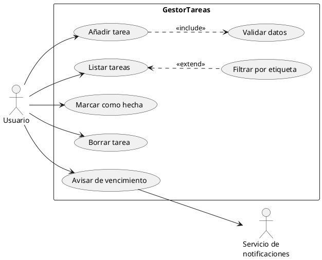
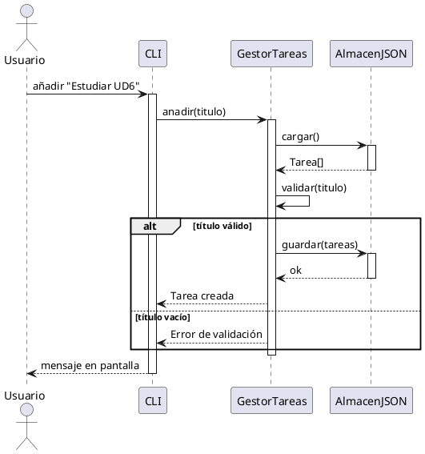
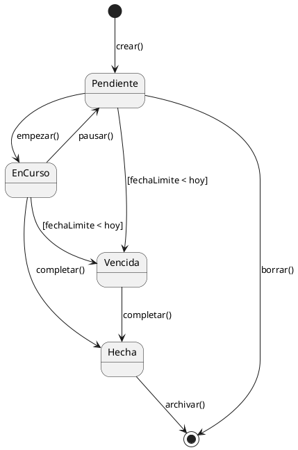
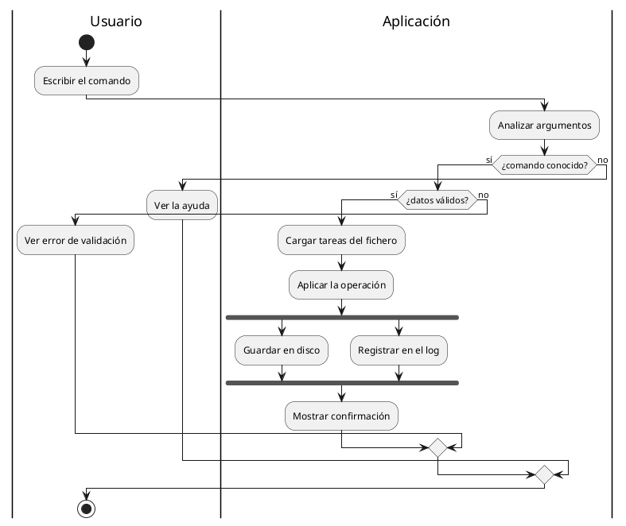

# Antes de empezar

## Qué vas a saber hacer al terminar esta unidad

Cubre el **RA6: representa el comportamiento de una aplicación mediante diagramas UML de
interacción, estados y actividades**. Al acabarla tienes que ser capaz de:

- Identificar los distintos tipos de diagramas de comportamiento y decir cuándo usar cada uno.
- Elaborar diagramas de casos de uso con actores y relaciones `include` y `extend`.
- Escribir la descripción textual de un caso de uso.
- Elaborar e interpretar diagramas de secuencia y de comunicación.
- Elaborar diagramas de estados y de actividades.
- Comprobar la coherencia entre los diagramas y con el diagrama de clases.

## Estructura vs comportamiento

En UD5 dibujamos una **fotografía**: qué clases hay y cómo se relacionan. Eso no dice nada de
qué ocurre cuando el programa se ejecuta.

Los diagramas de comportamiento son la **película**: quién llama a quién, en qué orden, qué
estados atraviesa un objeto, qué caminos sigue un proceso. Son los que de verdad explican **cómo
funciona** el sistema.

| Diagrama | Responde a la pregunta |
|---------------------------------------|-----------------------------------------------------------------------|
| **Casos de uso** | ¿Qué puede hacer cada tipo de usuario con el sistema? |
| **Secuencia** | ¿En qué orden se envían los mensajes entre objetos? |
| **Comunicación** | ¿Quién habla con quién? |
| **Estados** | ¿Por qué situaciones pasa un objeto y qué las provoca? |
| **Actividad** | ¿Cuál es el flujo del proceso, con sus decisiones y paralelismos? |
| Tiempos | ¿Cuándo ocurre cada cosa, con precisión temporal? |
| Visión general de interacción | ¿Cómo se encadenan varias interacciones? |

\newpage

# Diagramas de casos de uso

## Para qué sirven

Es el diagrama que se enseña al **cliente**. No tiene detalle técnico: describe qué
funcionalidades ofrece el sistema y a quién. Se elabora en la fase de **análisis de requisitos**
(UD1) y sirve de índice para todo lo demás.

## Elementos

| Elemento | Notación | Qué es |
|------------------|-----------------------|--------------------------------------------------------------------|
| **Actor** | Monigote | Rol externo que interactúa con el sistema. Puede ser una persona, otro sistema o un temporizador |
| **Caso de uso** | Elipse | Una funcionalidad completa que aporta valor al actor |
| **Sistema** | Rectángulo que engloba | La frontera de lo que estamos construyendo |
| **Asociación** | Línea | El actor participa en el caso de uso |

::: ojo
Un **actor no es una persona, es un rol**. La misma persona puede ser `Cliente` y
`Administrador`; son dos actores. Y un actor puede no ser humano: un sistema externo de pago, un
proceso programado que se ejecuta cada noche, un sensor.
:::

## Relaciones entre casos de uso

### `<<include>>` — inclusión

El caso base **siempre** ejecuta el incluido. Se usa para factorizar comportamiento común.

> «Añadir tarea» `<<include>>` «Validar datos»: no hay forma de añadir una tarea sin validar.

Flecha discontinua **desde** el caso base **hacia** el incluido.

### `<<extend>>` — extensión

El caso extensor se ejecuta **a veces**, bajo una condición, y añade comportamiento opcional al
base. El base funciona perfectamente sin él.

> «Filtrar por etiqueta» `<<extend>>` «Listar tareas»: normalmente listas sin filtrar.

Flecha discontinua **desde** la extensión **hacia** el caso base. **Ojo al sentido: es el
contrario que `include`.**

### Generalización

Un actor o caso de uso especializa a otro. `Administrador` generaliza a `Usuario`: hace todo lo
que hace un usuario, y más.

## Ejemplo




::: idea
Truco para no confundir las flechas: la punta de la flecha señala **de qué depende** cada cosa.
En `include`, el base **depende** del incluido (no funciona sin él) → apunta al incluido. En
`extend`, la extensión **depende** del base (no existe sin él) → apunta al base.
:::

## Descripción textual del caso de uso

El dibujo por sí solo es pobre. Cada elipse se acompaña de una **plantilla**:

```markdown
## CU-01: Añadir tarea

**Actor principal:** Usuario
**Partes interesadas:** Usuario (quiere apuntar rápido lo que tiene que hacer)
**Precondiciones:** La aplicación está instalada y el almacén es accesible.
**Postcondiciones (éxito):** Existe una tarea nueva, pendiente, con id único.
**Disparador:** El usuario ejecuta el comando `añadir`.

**Flujo principal (camino feliz)**
1. El usuario introduce el comando con un título.
2. El sistema valida que el título no esté vacío y tenga menos de 200 caracteres.
3. El sistema carga las tareas existentes.
4. El sistema genera un identificador único.
5. El sistema crea la tarea con estado «pendiente» y fecha de creación actual.
6. El sistema guarda la lista actualizada.
7. El sistema informa del éxito mostrando el identificador asignado.

**Flujos alternativos**
- 2a. Título vacío:
  1. El sistema muestra «El título no puede estar vacío».
  2. Vuelve al paso 1.
- 2b. Título demasiado largo:
  1. El sistema muestra el límite permitido y el caso de uso termina sin crear nada.
- 6a. No se puede escribir en el fichero:
  1. El sistema muestra el error del sistema operativo.
  2. La tarea no se crea. El caso de uso termina en fallo.

**Requisitos especiales:** La operación debe completarse en menos de 200 ms.
**Frecuencia:** Muy alta (decenas de veces al día).
```

::: ojo
Los **flujos alternativos** son la parte que todo el mundo se salta y la que más valor tiene:
son exactamente los **casos de prueba** que necesitarás en UD3. Un caso de uso bien descrito ya
te ha diseñado media batería de pruebas.
:::

::: practica
**P6.1 — Casos de uso de GestorTareas** (2 h)

1. Dibuja el diagrama de casos de uso **completo** de tu proyecto, incluyendo la funcionalidad
   que ya tiene y la que tienes planificada.
2. Debe incluir al menos: **dos actores** (uno no humano), **seis casos de uso**, una relación
   `<<include>>`, una `<<extend>>` y una generalización de actores.
3. Escribe la **descripción textual completa** de **dos** casos de uso, con la plantilla de
   arriba, con al menos tres flujos alternativos entre ambos.
4. Para cada flujo alternativo que hayas escrito, indica el **caso de prueba** de UD3 que le
   corresponde.
:::

\newpage

# Diagramas de interacción

Muestran cómo colaboran los objetos intercambiando mensajes. Hay dos variantes de la misma
información: **secuencia** (énfasis en el **tiempo**) y **comunicación** (énfasis en las
**relaciones**).

## Diagrama de secuencia

### Elementos

| Elemento | Notación |
|---------------------------------------|-----------------------------------------------------------------------|
| **Línea de vida** | Rectángulo arriba con el nombre, y línea vertical discontinua hacia abajo |
| **Especificación de ejecución** | Rectángulo estrecho sobre la línea de vida: el objeto está haciendo algo |
| **Mensaje síncrono** | Flecha con **punta rellena**; el emisor espera respuesta |
| **Mensaje asíncrono** | Flecha con **punta abierta**; el emisor sigue |
| **Respuesta (*return*)** | Flecha **discontinua** hacia atrás |
| **Autollamada** | Flecha que sale y vuelve al mismo objeto |
| **Creación** | Flecha `<<create>>` hacia una línea de vida que empieza más abajo |
| **Destrucción** | Una **X** al final de la línea de vida |

El tiempo transcurre **de arriba abajo**. El orden vertical de los mensajes es su orden de
ejecución.

### Fragmentos combinados

Permiten expresar lógica de control dentro del diagrama:

| Operador | Significa |
|--------------------------|------------------------------------------------------------------------------------|
| `alt` | Alternativa: varios caminos con condición (`if`/`else`) |
| `opt` | Opcional: se ejecuta si se cumple la guarda (`if` sin `else`) |
| `loop` | Bucle, con condición o número de repeticiones |
| `par` | Paralelo: los fragmentos se ejecutan concurrentemente |
| `break` | Ruptura del flujo |
| `critical` | Región que no puede interrumpirse |
| `ref` | Referencia a otro diagrama de secuencia |

### Ejemplo




::: idea
Un diagrama de secuencia es, literalmente, **la traza de ejecución dibujada**. Cuando en UD3
pongas un punto de ruptura y mires la **pila de llamadas**, estarás viendo el mismo diagrama en
vertical. Son dos vistas de lo mismo.
:::

## Diagrama de comunicación

Los mismos mensajes, pero colocando los objetos como en un grafo y **numerando** los mensajes
para indicar el orden.


La numeración puede ser jerárquica: `1`, `2`, `2.1`, `2.2`, `2.2.1`, que indica anidamiento de
llamadas.

| | Secuencia | Comunicación |
|-------------------------------------|---------------------------------|---------------------------------------|
| Énfasis | **Orden temporal** | **Estructura de la colaboración** |
| Orden | Posición vertical | Numeración de los mensajes |
| Lógica de control | Fragmentos (`alt`, `loop`) | Difícil de expresar |
| Legibilidad con muchos mensajes | Buena | Se convierte en una maraña |
| Uso real hoy | Muy frecuente | Poco frecuente |

::: ojo
Son **semánticamente equivalentes**: de uno se puede obtener el otro automáticamente. En el
examen puede pedirse convertir uno en otro.
:::

\newpage

# Diagramas de estados

## Para qué

Muestran el **ciclo de vida de un objeto**: por qué estados pasa, qué eventos provocan los
cambios y qué se hace en cada uno. Son especialmente útiles cuando un objeto se comporta de
forma distinta según su estado: un pedido, una reserva, una conexión, una partida.

## Elementos

| Elemento | Notación |
|-----------------------------------------|---------------------------------------------------------------------|
| **Estado inicial** | Círculo negro relleno |
| **Estado** | Rectángulo redondeado con el nombre |
| **Transición** | Flecha entre estados |
| **Estado final** | Círculo con anillo |
| **Estado compuesto** | Estado que contiene otros estados dentro |
| **Estado histórico** | Círculo con una `H`: recuerda dónde estaba |

### Sintaxis de una transición

```
evento [guarda] / acción
```

- **Evento**: qué la dispara (`completar()`, `timeout`).
- **Guarda**: condición booleana que debe cumplirse (`[saldo > 0]`).
- **Acción**: qué se ejecuta al transitar (`/ enviarCorreo()`).

Los tres son opcionales, pero una transición sin evento ni guarda es automática.

### Acciones dentro de un estado

```
Estado Pendiente
  entry / registrarInicio()     ← al entrar
  do / comprobarVencimiento()   ← mientras está en el estado
  exit / registrarFin()         ← al salir
```

## Ejemplo




::: idea
Un diagrama de estados es una **máquina de estados**, y se traduce a código casi
mecánicamente: un `enum` con los estados y una tabla o un `switch` con las transiciones válidas.
Además te da gratis la lista de transiciones **inválidas** que debes rechazar y probar:
¿qué pasa si alguien intenta `completar()` una tarea que ya está `Hecha`?
:::

```javascript
const ESTADO = Object.freeze({
  PENDIENTE: 'pendiente', EN_CURSO: 'enCurso',
  HECHA: 'hecha', VENCIDA: 'vencida',
});

const TRANSICIONES = {
  [ESTADO.PENDIENTE]: { empezar: ESTADO.EN_CURSO, vencer: ESTADO.VENCIDA },
  [ESTADO.EN_CURSO]:  { pausar: ESTADO.PENDIENTE, completar: ESTADO.HECHA,
                        vencer: ESTADO.VENCIDA },
  [ESTADO.VENCIDA]:   { completar: ESTADO.HECHA },
  [ESTADO.HECHA]:     {},
};

aplicar(evento) {
  const destino = TRANSICIONES[this.estado][evento];
  if (!destino) throw new Error(`No se puede '${evento}' desde '${this.estado}'`);
  this.estado = destino;
}
```

\newpage

# Diagramas de actividad

## Para qué

Modelan un **flujo de trabajo o un algoritmo**: la secuencia de acciones, las decisiones, lo que
puede ocurrir en paralelo y quién hace cada cosa. Es el diagrama de UML más parecido a un
diagrama de flujo clásico, pero con más capacidad expresiva.

Se usa para: describir un proceso de negocio, detallar el flujo interno de un caso de uso, o
documentar un algoritmo complejo.

## Elementos

| Elemento | Notación |
|----------------------------------------|----------------------------------------------------------------------|
| **Nodo inicial** | Círculo negro |
| **Acción** | Rectángulo redondeado |
| **Flujo** | Flecha |
| **Decisión** | Rombo con una entrada y varias salidas con guardas |
| **Fusión** (*merge*) | Rombo con varias entradas y una salida |
| **Bifurcación** (*fork*) | Barra gruesa: una entrada, varias salidas **en paralelo** |
| **Unión** (*join*) | Barra gruesa: espera a que terminen todas las ramas |
| **Nodo final de actividad** | Círculo con anillo: termina todo |
| **Nodo final de flujo** | Círculo con aspa: termina esa rama |
| **Calle** (*swimlane*) | Columna o fila que indica **quién** hace cada acción |
| **Objeto** | Rectángulo: dato que fluye entre acciones |

::: ojo
**Decisión vs bifurcación** es el error típico:

- **Rombo (decisión)**: se elige **un** camino. Es un `if`.
- **Barra (fork)**: se toman **todos** los caminos a la vez. Es concurrencia.

Y toda bifurcación debe tener su **unión** correspondiente, igual que todo `fork` necesita su
`join`.
:::

## Ejemplo




Fíjate en las **calles** (`|Usuario|`, `|Aplicación|`): separan visualmente quién es responsable
de cada acción. Es lo que hace que este diagrama se entienda de un vistazo en una reunión con el
cliente.

\newpage

# Coherencia entre diagramas

Criterio RA6-f y RA6-g: los diagramas no son dibujos sueltos, forman **un modelo**. Deben
encajar entre sí y con el código.

## Reglas de coherencia que debes comprobar

| Comprobación | Qué verificar |
|------------------------------|--------------------------------------------------------------------------------|
| Casos de uso ↔ Actividad | Cada flujo alternativo del caso de uso aparece como un camino en el diagrama de actividad |
| Casos de uso ↔ Secuencia | Cada caso de uso importante tiene su diagrama de secuencia |
| Secuencia ↔ Clases | **Todo objeto de la secuencia es una clase del diagrama de clases** |
| Secuencia ↔ Clases | **Todo mensaje es un método público de la clase receptora**, con los mismos parámetros |
| Secuencia ↔ Clases | Si A envía un mensaje a B, debe existir una relación (asociación o dependencia) A→B |
| Estados ↔ Clases | Los estados corresponden a valores de un atributo de la clase |
| Estados ↔ Secuencia | Los eventos de las transiciones son mensajes que aparecen en las secuencias |
| Todos ↔ Código | Los nombres coinciden exactamente: `anadir`, no `añadirTarea` en un sitio y `agregar` en otro |

::: idea
Esta tabla es, en la práctica, **una lista de comprobación de revisión**. Es exactamente lo que
hacen las herramientas CASE integradas cuando validan el modelo. Cuando en UD2 hablamos de que
una herramienta I-CASE «comprueba la consistencia entre diagramas», esto es lo que comprueba.
:::

## Errores de coherencia frecuentes

- Un objeto en el diagrama de secuencia que no existe en el de clases (o al revés).
- Un mensaje `guardarTodo()` en la secuencia cuando la clase tiene `guardar()`.
- Un estado en el diagrama de estados que ninguna transición puede alcanzar.
- Un caso de uso que nadie usa: ningún actor conectado.
- Multiplicidades que contradicen la secuencia: el diagrama de clases dice `0..1` pero la
  secuencia recorre una colección con `loop`.

\newpage

::: practica
**P6.2 — Secuencia y comunicación** (2 h)

Sobre `GestorTareas`:

1. Diagrama de **secuencia** de la operación «marcar tarea como hecha», incluyendo:
   - Al menos cuatro líneas de vida.
   - Un fragmento `alt` (la tarea existe / no existe).
   - Un fragmento `loop` (búsqueda en la colección).
   - Al menos una autollamada.
   - Mensajes de respuesta correctamente dibujados.
2. Convierte ese mismo diagrama en un diagrama de **comunicación** con numeración jerárquica.
3. **Comprueba la coherencia** con tu diagrama de clases de UD5, usando la tabla de la página
   anterior. Escribe qué incoherencias has encontrado y cómo las has resuelto: o cambias el
   diagrama o cambias el código.
:::

::: practica
**P6.3 — Estados y actividad** (2 h)

1. Amplía el ciclo de vida de `Tarea` con un estado nuevo: `Archivada`, al que se llega desde
   `Hecha` después de 30 días. Redibuja el diagrama de estados completo con `entry`/`exit` en al
   menos dos estados y una guarda con condición temporal.
2. Implementa la máquina de estados en JavaScript siguiendo el patrón de la tabla de
   transiciones, y escribe pruebas de Jest que comprueben **al menos tres transiciones
   inválidas**.
3. Dibuja el diagrama de **actividad** del proceso completo «cierre semanal»: el usuario revisa
   todas las tareas, las vencidas se marcan, las hechas se archivan, se genera un informe y, en
   paralelo, se envía por correo y se guarda en disco. Usa **calles**, al menos una decisión y
   una bifurcación con su unión.
:::

\newpage

# Los mismos diagramas en Visual Paradigm

Todo lo de esta unidad se puede dibujar con PlantUML, y es lo que se usa en clase porque es texto
y se versiona. Pero los enunciados que os vais a encontrar —aquí y fuera— suelen presuponer
Visual Paradigm, así que estas son las equivalencias y las trampas.

| Diagrama | Dónde está en Visual Paradigm |
|-------------------------------------|-------------------------------------------------------------------------|
| Casos de uso | *New Diagram → Use Case Diagram* |
| Secuencia | *New Diagram → Sequence Diagram* |
| Comunicación | *New Diagram → Communication Diagram* |
| Estados | *New Diagram → State Machine Diagram* |
| Actividad | *New Diagram → Activity Diagram* |

## Casos de uso

- El **sistema** se dibuja con la herramienta *System*, no con un rectángulo cualquiera: si usas
  un rectángulo suelto, la herramienta no lo trata como frontera y no valida nada.
- `<<include>>` y `<<extend>>` están en *Include* y *Extend* de la barra, no se escriben a mano
  como estereotipo sobre una dependencia. La flecha apunta **del caso base al incluido** en
  `include`, y **del caso de extensión al base** en `extend`. Es el error más repetido.
- La descripción textual del caso de uso se escribe en el propio elemento: doble clic →
  pestaña **Description**, o *Use Case Details* para la plantilla con flujos.

## Secuencia

- Los objetos son *LifeLine*. Se nombran `objeto : Clase` (con los dos puntos), no solo `Clase`.
- Las **activaciones** (barras verticales) las dibuja sola al crear el mensaje; no las pintes a
  mano.
- Los mensajes de **respuesta** son *Return Message* (flecha discontinua). Si los dibujas como
  mensajes normales, el diagrama queda mal y cuenta como error de notación.
- Los **fragmentos combinados** (`alt`, `opt`, `loop`, `par`) son *Combined Fragment*: se
  selecciona el rango de mensajes y se aplica.

## Estados

- El estado inicial es *Initial Pseudo State* (círculo relleno) y el final *Final State* (círculo
  con anillo). Son elementos distintos; no valen dos círculos iguales.
- La sintaxis de la transición se escribe en su etiqueta:
  `evento [guarda] / acción`. Los corchetes y la barra son obligatorios.

## Actividad

- Las **calles** son *Swimlane* (horizontal o vertical). Se añaden desde la propia herramienta
  *Swimlane*, no dibujando rectángulos.
- Cuidado con confundir *Decision Node* (rombo, una sola rama se toma) con *Fork Node* (barra
  gruesa, **todas** las ramas se ejecutan en paralelo). Y todo *fork* necesita su *join*.

::: ojo
La Community Edition **pone marca de agua** en las exportaciones. Para entregar, usa
*File → Export → PNG* con *Diagram only*: la marca sigue estando, pero el diagrama sale limpio y
completo. No recortes capturas de pantalla, porque se pierde resolución y suele quedar cortado.
:::

::: idea
La herramienta no es el contenido evaluable: el criterio pide notación UML correcta y coherencia
entre diagramas, no una herramienta concreta. Entrega en la que te sientas seguro, pero
**sabiendo usar las dos**, porque eso sí que te lo van a pedir en una empresa.
:::

::: practica
**P6.4 — Proyecto integrador (entrega evaluable del módulo)**

Documento de diseño completo de `GestorTareas`, en un repositorio, con todos los diagramas en
PlantUML versionados en `docs/`. **Dos de ellos, a tu elección, además en Visual Paradigm**,
exportados a PNG y con una nota de media página sobre qué te resultó más cómodo en cada caso.

**Contenido obligatorio**

1. Diagrama de **casos de uso** completo (UD6) con dos actores mínimo.
2. Descripción textual de **tres** casos de uso, con flujos alternativos.
3. Diagrama de **clases** actualizado (UD5), coherente con el código actual.
4. **Dos** diagramas de **secuencia** de los casos de uso más complejos, con fragmentos
   combinados.
5. **Un** diagrama de **comunicación** equivalente a uno de los anteriores.
6. **Un** diagrama de **estados** de la clase `Tarea`.
7. **Un** diagrama de **actividad** con calles de un proceso de negocio.
8. Un apartado de **verificación de coherencia**: la tabla de comprobaciones rellenada, con las
   incoherencias detectadas y cómo se resolvieron.
9. Un apartado de **trazabilidad**: tabla que relacione cada caso de uso con los casos de prueba
   de UD3 y con las clases de UD5 que lo implementan.

**Rúbrica**

| Criterio | Peso | Nivel alto | Nivel medio | Nivel bajo |
|-----------------|-------|------------------------------------------|-----------------------|---------------------|
| Casos de uso | 15 % | Actores y relaciones correctas, descripciones completas | Diagrama correcto, descripciones flojas | Solo el dibujo |
| Diagramas de interacción | 25 % | Fragmentos combinados bien usados, respuestas y activaciones correctas | Secuencia básica correcta | Notación incorrecta |
| Estados | 15 % | Eventos, guardas y acciones; transiciones inválidas identificadas | Estados y transiciones correctos | Incompleto |
| Actividad | 15 % | Calles, decisión y fork/join bien diferenciados | Flujo correcto sin calles | Diagrama de flujo sin notación UML |
| Coherencia | 20 % | Tabla completa, incoherencias reales detectadas y resueltas | Revisión superficial | Sin revisar |
| Trazabilidad y presentación | 10 % | Trazabilidad completa, todo versionado en PlantUML y los dos diagramas en Visual Paradigm | Parcial | Ausente |
:::

\newpage

# Resumen de la unidad

| Concepto | En una línea |
|----------------------------------------|----------------------------------------------------------------------|
| Diagramas de comportamiento | Muestran qué ocurre cuando el sistema se ejecuta |
| Actor | Un **rol** externo: persona, otro sistema o temporizador |
| Caso de uso | Funcionalidad completa que aporta valor a un actor |
| `<<include>>` | El base **siempre** ejecuta el incluido; flecha hacia el incluido |
| `<<extend>>` | Comportamiento **opcional**; flecha hacia el base |
| Descripción textual | Precondiciones, flujo principal y flujos alternativos |
| Flujos alternativos | La fuente natural de los casos de prueba |
| Línea de vida | Objeto participante en un diagrama de secuencia |
| Mensaje síncrono / asíncrono | Punta rellena (espera) / punta abierta (no espera) |
| `alt` / `opt` / `loop` / `par` | if-else / if / bucle / paralelo |
| Diagrama de comunicación | Misma información que la secuencia, con mensajes numerados |
| Estado | Situación en la que un objeto espera un evento |
| Transición | `evento [guarda] / acción` |
| `entry` / `do` / `exit` | Acciones al entrar, durante y al salir de un estado |
| Decisión (rombo) | Se elige **un** camino |
| Bifurcación (barra) | Se toman **todos** los caminos en paralelo; requiere unión |
| Calle (*swimlane*) | Indica **quién** ejecuta cada acción |
| Coherencia | Todo objeto de la secuencia es una clase; todo mensaje, un método |
| Trazabilidad | Poder seguir un requisito hasta el código y la prueba |

# Autoevaluación

1. «Pagar con tarjeta» y «Realizar pedido»: ¿`include` o `extend`? ¿Hacia dónde va la flecha?
2. ¿Puede un actor ser un sistema automático? Pon un ejemplo.
3. En un diagrama de secuencia, ¿qué significa una flecha discontinua hacia la izquierda?
4. ¿Cuándo usarías `par` en lugar de poner los mensajes uno debajo de otro?
5. Explica la diferencia entre un rombo y una barra gruesa en un diagrama de actividad.
6. Escribe la transición UML: «desde Reservada se pasa a Confirmada cuando se recibe el pago,
   siempre que el importe sea el correcto, y al hacerlo se envía un correo».
7. ¿Cómo se traduce un diagrama de estados a código? ¿Qué te da gratis para las pruebas?
8. Tu diagrama de secuencia envía `obtenerTodas()` a `AlmacenJSON`, pero en el diagrama de
   clases ese método no existe. ¿Qué haces?
9. ¿Qué aporta un diagrama de comunicación que no aporte uno de secuencia, y al revés?
10. Un diagrama de estados tiene un estado al que no llega ninguna transición. ¿Es un error?
    ¿Por qué?
